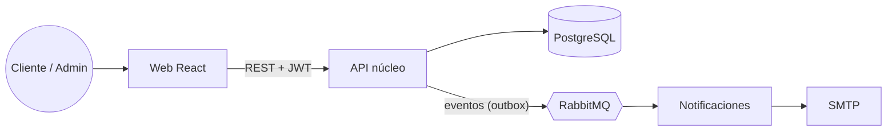

# Centro Deportivo Los Robles

Sistema de reservas de canchas y alquiler de implementos deportivos del Centro Deportivo Los Robles.

> Estado: **Sprint 0 — fundaciones**. Por ahora el repositorio contiene la documentación de diseño; el código se construye sprint a sprint.

## Arquitectura en una línea
Monolito modular hexagonal (**API núcleo**) + **servicio de notificaciones** desacoplado por eventos con **RabbitMQ**, sobre **PostgreSQL 17**, frontend **React**, todo levantado con **Docker Compose**.

## Documentación
| Documento | Contenido |
|---|---|
| [docs/ARQUITECTURA.md](docs/ARQUITECTURA.md) | Alcance, reglas de negocio, stack, estructura del monorepo, modelo de datos, API, patrones de diseño, Docker, seguridad, ADRs |
| [docs/C4.md](docs/C4.md) | Diagramas C4: contexto, contenedores, componentes, código, despliegue y dinámico |
| [docs/SCRUM.md](docs/SCRUM.md) | Roles, ceremonias, DoR/DoD, flujo Git, product backlog (149 pts) y plan de sprints |

## Stack
React 19 · Vite · Tailwind · TanStack Query · Node 22 · Express 5 · TypeScript · Knex · PostgreSQL 17 · RabbitMQ 4 · Docker Compose · Vitest · Playwright · GitHub Actions

## Flujo de trabajo
- Ramas: `main` (estable) · `develop` (integración) · `feature/HU-XX-descripcion`.
- Commits: [Conventional Commits](https://www.conventionalcommits.org/es/).
- Cada historia de usuario es un issue; el tablero está en GitHub Projects.

## Cómo levantarlo
_Disponible al terminar el Sprint 0 (`docker compose up`)._
