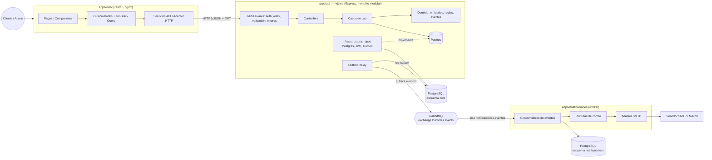
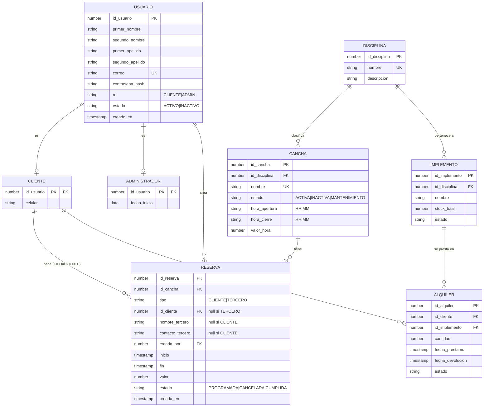
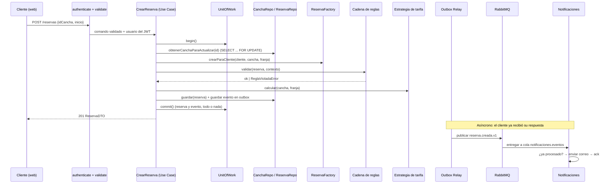

# Arquitectura — Centro Deportivo Los Robles (v2)

> Rediseño desde cero de la app de reservas del Centro Deportivo Los Robles.
> Se toma como base funcional el prototipo anterior del equipo y se corrigen sus problemas estructurales.
> Diagramas C4 (contexto, contenedores, componentes, código y despliegue): [C4.md](./C4.md) · Proceso: [SCRUM.md](./SCRUM.md).

---

## 1. Qué hace el sistema (alcance)

| Módulo | Cliente | Administrador |
|---|---|---|
| **Autenticación** | Registrarse, iniciar/cerrar sesión | Iniciar/cerrar sesión |
| **Perfil** | Ver y editar sus datos y contraseña | Ver y editar sus datos |
| **Disciplinas** | Consultar (Fútbol, Baloncesto, Voleibol, Tenis) | CRUD |
| **Canchas** | Consultar canchas y su información | CRUD, cambiar estado (ACTIVA / INACTIVA / MANTENIMIENTO), horario y valor |
| **Reservas** | Reservar, ver mis reservas, ver detalle, cancelar | Ver todas, reservar a nombre de un tercero (nombre + contacto), cancelar |
| **Implementos** | Consultar disponibles | CRUD de inventario |
| **Alquiler de implementos** | Alquilar, ver mis alquileres | Registrar devolución, ver todos |

### Reglas de negocio heredadas (se mantienen)
- RN-01: Una reserva dura **1 hora** y empieza en hora entera.
- RN-02: Solo se reserva entre **hoy y hoy + 30 días**; hoy no se permiten horas ya pasadas.
- RN-03: La franja debe estar **dentro del horario de la cancha** (apertura–cierre).
- RN-04: Solo se reservan canchas en estado **ACTIVA**.
- RN-05: **No puede haber dos reservas activas** en la misma cancha y franja.
- RN-06: Hora de apertura < hora de cierre.

### Reglas nuevas propuestas
- RN-07: Un cliente solo puede cancelar con al menos **2 h de anticipación** (configurable). El admin puede cancelar siempre.
- RN-08: No se puede alquilar más implementos que el stock disponible.
- RN-09: El rol de administrador **no se deduce del correo**; lo asigna otro administrador o el seed.

---

## 2. Problemas del repo original que esta arquitectura corrige

| Problema encontrado | Solución en v2 |
|---|---|
| Riesgo de versionar secretos de configuración (`.env`) junto al código | `.env` en `.gitignore`, solo `.env.example`; secretos en el proveedor de despliegue. |
| Notificaciones inexistentes | Servicio de notificaciones asíncrono (correo de confirmación, cancelación y recordatorio) |
| Sin autenticación real: la sesión y el rol de administrador se confiaban al cliente | **JWT** firmado (access + refresh), middleware `authenticate` + `authorize(rol)` |
| Admin = correo `@losrobles.com` | Rol explícito en BD |
| Perfil consultado/editado sin verificar la identidad del usuario | `/me` basado en el token |
| SQL escrito dentro de las rutas Express | Capas: controller → caso de uso → repositorio |
| Dos tablas de reserva (`TBL_RESERVA` y `TBL_RESERVA_TERCEROS`) con lógica duplicada | Una sola tabla `RESERVA` con `TIPO` (CLIENTE / TERCERO) |
| Fecha y horas guardadas como `VARCHAR2(5)` | `TIMESTAMP` para inicio y fin |
| `any` por todos lados y mapeos `r.id ?? r.ID ?? r.ID_TIPO_CANCHA` | Contratos tipados compartidos (`packages/shared`) con **Zod** |
| Componentes de 500–700 líneas | Componentes pequeños + hooks + capa de servicios |
| Seeds con contraseñas en texto plano | Seeds con hash bcrypt |
| Implementos/alquiler con frontend pero sin API | Módulos completos |
| Cero pruebas, README de plantilla | Pruebas unitarias + integración, CI, README real |

---

## 3. Stack tecnológico

| Capa | Tecnología | Por qué |
|---|---|---|
| Frontend | React 19 + TypeScript + Vite + Tailwind | Igual que el original: el equipo ya lo conoce |
| Estado de servidor | TanStack Query | Caché, reintentos y estados de carga sin código repetido |
| Formularios | React Hook Form + Zod | Validación con los mismos esquemas del backend |
| Router | React Router (rutas protegidas por rol) | |
| Backend | Node 22 + Express 5 + TypeScript | Igual que el original |
| Base de datos | **PostgreSQL 17** (Docker) | Relacional y ACID; `EXCLUDE USING gist` impide reservas solapadas a nivel de BD; imagen liviana; despliegue gratis fácil |
| Acceso a datos | Knex (query builder + migraciones) | Migraciones versionadas en vez de scripts sueltos |
| Mensajería | **RabbitMQ 4** (Docker) + `amqplib` | Comunicación asíncrona entre el núcleo y el servicio de notificaciones |
| Servicio de notificaciones | Node 22 + TypeScript (worker sin HTTP público) + Nodemailer (Mailpit en desarrollo) | Envía correos de confirmación/cancelación sin frenar la API |
| Contenedores | Docker + Docker Compose | Todo el entorno se levanta con `docker compose up` |
| Auth | JWT + bcrypt | |
| Pruebas | Vitest, Supertest, Testing Library, Playwright (E2E) | |
| Calidad | ESLint, Prettier, Husky + lint-staged, Conventional Commits | |
| CI/CD | GitHub Actions → front en GitHub Pages/Vercel, API en Render (Docker) | |
| Docs API | OpenAPI (Swagger UI en `/api/docs`) | |

---

## 4. Estilo arquitectónico elegido

**Monolito modular con arquitectura hexagonal + servicio de notificaciones desacoplado por eventos (Event-Driven).**

- El **núcleo** (`apps/api`) contiene los módulos auth, usuarios, disciplinas, canchas, reservas, implementos y alquileres. Todo lo transaccional (en especial "bloquear franja + crear reserva") ocurre en **una sola transacción de PostgreSQL**.
- El **servicio de notificaciones** (`apps/notificaciones`) es un proceso independiente, con su propio contenedor y su propio esquema de BD, que **solo se comunica por eventos** a través de RabbitMQ. Si se cae, las reservas siguen funcionando; los mensajes esperan en la cola y se envían cuando vuelve.
- **¿Por qué no microservicios completos?** La reserva necesita consistencia fuerte entre cancha y reserva; partirla en servicios exigiría Sagas y compensaciones. Se separa solo lo que es naturalmente asíncrono (notificar).
- **Camino de evolución:** cada módulo del núcleo tiene límites claros (no lee tablas de otros módulos y se comunica por interfaces o eventos), así que puede extraerse a un microservicio más adelante si hace falta.

### Vista general



**Regla de dependencias:** `http → application → domain`. La infraestructura implementa las interfaces (puertos) del dominio. El dominio no importa Express, Knex, PostgreSQL ni RabbitMQ.

### Eventos publicados (contratos en `packages/shared/events`)

| Evento | Lo emite | Datos | Lo consume |
|---|---|---|---|
| `usuario.registrado.v1` | auth | idUsuario, nombre, correo | notificaciones (bienvenida) |
| `reserva.creada.v1` | reservas | idReserva, cancha, inicio, fin, valor, destinatario | notificaciones (confirmación) |
| `reserva.cancelada.v1` | reservas | idReserva, canceladaPor, motivo, destinatario | notificaciones (aviso) |
| `reserva.recordatorio.v1` | reservas (job programado) | idReserva, inicio, destinatario | notificaciones (recordatorio 2 h antes) |
| `alquiler.vencido.v1` | alquileres (job) | idAlquiler, implemento, destinatario | notificaciones |

Sobre de todos los mensajes: `{ id (uuid), tipo, version, ocurridoEn, correlationId, datos }`.

La API y el worker declaran el exchange `losrobles.events` (topic, durable) al conectarse. El worker declara la cola quorum `notificaciones.eventos`, con bindings `usuario.#`, `reserva.#` y `alquiler.#`. También declara `notificaciones.eventos.retry` (TTL de 10 s y retorno a la cola principal) y `notificaciones.eventos.dlq`. Los mensajes inválidos llegan directamente a la DLQ. Los fallos de procesamiento admiten hasta tres reintentos.

---

## 5. Estructura del repositorio (monorepo con npm workspaces)

```
los-robles/
├─ apps/
│  ├─ api/
│  │  ├─ src/
│  │  │  ├─ main.ts                  # arranque del servidor
│  │  │  ├─ app.ts                   # crea la app Express (testeable)
│  │  │  ├─ container.ts             # Composition Root (inyección de dependencias)
│  │  │  ├─ config/env.ts            # lectura y validación de variables (Zod)
│  │  │  ├─ shared/
│  │  │  │  ├─ domain/               # Entity, ValueObject, DomainError, DomainEvent, Result
│  │  │  │  ├─ application/          # UnitOfWork, EventPublisher, Clock (interfaces)
│  │  │  │  ├─ infrastructure/       # PostgresConnection (singleton), KnexUnitOfWork,
│  │  │  │  │                        # OutboxEventPublisher, OutboxRelay, RabbitMqPublisher
│  │  │  │  └─ http/                 # errorHandler, validate(schema), authenticate, authorize
│  │  │  └─ modules/
│  │  │     ├─ auth/
│  │  │     ├─ usuarios/
│  │  │     ├─ disciplinas/
│  │  │     ├─ canchas/
│  │  │     ├─ reservas/
│  │  │     │  ├─ domain/
│  │  │     │  │  ├─ Reserva.ts                 # entidad raíz
│  │  │     │  │  ├─ estados/                   # State: Programada, Cancelada, Cumplida
│  │  │     │  │  ├─ FranjaHoraria.ts           # value object (inicio, fin)
│  │  │     │  │  ├─ ReservaFactory.ts          # Factory: cliente vs tercero
│  │  │     │  │  ├─ reglas/                    # Chain of Responsibility de validaciones
│  │  │     │  │  ├─ tarifas/                   # Strategy de cálculo de precio
│  │  │     │  │  ├─ eventos/                   # ReservaCreada, ReservaCancelada
│  │  │     │  │  └─ ReservaRepository.ts       # puerto (interfaz)
│  │  │     │  ├─ application/
│  │  │     │  │  ├─ CrearReserva.ts
│  │  │     │  │  ├─ CrearReservaTercero.ts
│  │  │     │  │  ├─ CancelarReserva.ts
│  │  │     │  │  ├─ ListarReservas.ts
│  │  │     │  │  └─ ConsultarDisponibilidad.ts
│  │  │     │  ├─ infrastructure/
│  │  │     │  │  ├─ PgReservaRepository.ts     # adapter
│  │  │     │  │  └─ ReservaMapper.ts           # fila BD ↔ entidad ↔ DTO
│  │  │     │  └─ http/
│  │  │     │     ├─ reservas.controller.ts
│  │  │     │     └─ reservas.routes.ts
│  │  │     ├─ implementos/
│  │  │     └─ alquileres/
│  │  ├─ db/
│  │  │  ├─ migrations/              # Knex, versionadas
│  │  │  └─ seeds/                   # datos de prueba con contraseñas hasheadas
│  │  ├─ test/                       # integración (Supertest)
│  │  └─ Dockerfile
│  ├─ notificaciones/                # servicio independiente (worker)
│  │  ├─ src/
│  │  │  ├─ main.ts                  # conecta a RabbitMQ y registra consumidores
│  │  │  ├─ domain/                  # Notificacion, Canal, PlantillaFactory
│  │  │  ├─ application/             # EnviarConfirmacionReserva, EnviarAvisoCancelacion...
│  │  │  ├─ infrastructure/
│  │  │  │  ├─ messaging/            # RabbitMqConsumer, reintentos, DLQ
│  │  │  │  ├─ mail/SmtpMailer.ts    # adapter de Nodemailer
│  │  │  │  ├─ templates/            # plantillas HTML de correo
│  │  │  │  └─ PgMensajesProcesadosRepository.ts  # idempotencia
│  │  │  └─ handlers/                # un handler por tipo de evento
│  │  ├─ db/migrations/              # esquema "notificaciones"
│  │  └─ Dockerfile
│  └─ web/
│     └─ src/
│        ├─ app/                     # router, providers (QueryClient, Auth), layout
│        ├─ features/                # una carpeta por módulo (misma división que la API)
│        │  ├─ auth/        (pages, components, hooks, api.ts)
│        │  ├─ perfil/
│        │  ├─ canchas/
│        │  ├─ reservas/
│        │  ├─ implementos/
│        │  └─ alquileres/
│        ├─ shared/
│        │  ├─ api/httpClient.ts     # fetch + token + refresh + manejo de errores
│        │  ├─ components/ui/        # Button, Input, Modal, Table, DatePicker...
│        │  ├─ hooks/
│        │  └─ lib/
│        └─ assets/
├─ packages/
│  └─ shared/                        # esquemas Zod, DTOs, enums y contratos de eventos (events/)
├─ docs/                             # este documento, SCRUM, ADRs, diagramas C4
├─ infra/
│  └─ postgres/init/01-esquemas.sh   # crea esquemas, roles por servicio y btree_gist
├─ .github/workflows/ci.yml
├─ docker-compose.yml                # entorno completo de desarrollo (ver sección 9)
├─ .env.example
└─ README.md
```

---

## 6. Modelo de datos (v2)



Restricciones clave (PostgreSQL, esquema `core`):
- `CHECK` en estados y tipo; `CHECK ((tipo='CLIENTE' AND id_cliente IS NOT NULL) OR (tipo='TERCERO' AND nombre_tercero IS NOT NULL))`.
- **RN-05 garantizada por la BD**, sin depender del código:
  ```sql
  CREATE EXTENSION IF NOT EXISTS btree_gist;
  ALTER TABLE core.reserva ADD CONSTRAINT reserva_sin_solapamiento
    EXCLUDE USING gist (id_cancha WITH =, tstzrange(inicio, fin, '[)') WITH &&)
    WHERE (estado = 'PROGRAMADA');
  ```
  Una franja cancelada se puede volver a reservar; dos reservas que se crucen en la misma cancha son imposibles aunque lleguen al mismo milisegundo.
- IDs con `GENERATED ALWAYS AS IDENTITY`; fechas con `timestamptz` (zona `America/Bogota` en la presentación).
- Correo único sin distinguir mayúsculas: `UNIQUE (lower(correo))`.

Tablas de soporte:
- `core.outbox` (`id uuid, tipo, payload jsonb, creado_en, publicado_en`) — Transactional Outbox.
- `notificaciones.mensaje_procesado` (`id_mensaje uuid PK, procesado_en`) — idempotencia del consumidor.
- `notificaciones.notificacion` (`id, tipo, destinatario, estado ENVIADA|FALLIDA, intentos, enviado_en`) — historial.

Cada servicio tiene **su propio esquema y su propio usuario de BD**: la API no puede leer `notificaciones.*` y el worker no puede leer `core.*`. Comparten el contenedor de PostgreSQL para ahorrar recursos, pero quedan separados como si fueran dos bases de datos.

---

## 7. API REST (v1)

| Método | Ruta | Rol | Descripción |
|---|---|---|---|
| POST | `/api/v1/auth/register` | público | Registro de cliente |
| POST | `/api/v1/auth/login` | público | Devuelve access + refresh token |
| POST | `/api/v1/auth/refresh` | público | Renueva el access token |
| GET/PATCH | `/api/v1/me` | autenticado | Ver / editar mi perfil |
| PATCH | `/api/v1/me/password` | autenticado | Cambiar contraseña |
| GET | `/api/v1/disciplinas` | público | Listar |
| POST/PUT/DELETE | `/api/v1/disciplinas/:id?` | ADMIN | CRUD |
| GET | `/api/v1/canchas?disciplina=&estado=` | público | Listar con filtros |
| GET | `/api/v1/canchas/:id` | público | Detalle |
| GET | `/api/v1/canchas/:id/disponibilidad?fecha=YYYY-MM-DD` | autenticado | Franjas libres del día |
| POST/PUT | `/api/v1/canchas/:id?` | ADMIN | Crear / editar |
| PATCH | `/api/v1/canchas/:id/estado` | ADMIN | Cambiar estado |
| GET | `/api/v1/reservas` | autenticado | Cliente: las suyas · Admin: todas (filtros) |
| GET | `/api/v1/reservas/:id` | dueño o ADMIN | Detalle |
| POST | `/api/v1/reservas` | CLIENTE | Reservar |
| POST | `/api/v1/reservas/terceros` | ADMIN | Reservar a nombre de un tercero |
| PATCH | `/api/v1/reservas/:id/cancelar` | dueño o ADMIN | Cancelar |
| GET/POST/PUT | `/api/v1/implementos` | GET público · resto ADMIN | Inventario |
| GET/POST | `/api/v1/alquileres` | autenticado | Mis alquileres / alquilar |
| PATCH | `/api/v1/alquileres/:id/devolver` | ADMIN | Registrar devolución |

Formato de error único: `{ "error": { "code": "CANCHA_NO_ACTIVA", "message": "...", "details": [] } }` con el código HTTP correcto (400 validación, 401, 403, 404, 409 conflicto de franja/estado, 422 regla de negocio).

---

## 8. Patrones de diseño

### 8.1 Backend

| Patrón | Tipo | Dónde | Qué problema resuelve |
|---|---|---|---|
| **Arquitectura hexagonal (Ports & Adapters)** | Arquitectónico | Todos los módulos | El dominio no depende de Express, PostgreSQL ni RabbitMQ; se puede probar sin BD |
| **Monolito modular** | Arquitectónico | `modules/*` | Cada módulo es independiente y coincide con un épico de SCRUM → el equipo trabaja en paralelo sin pisarse |
| **Repository** | Acceso a datos | `ReservaRepository`, `CanchaRepository`... | Saca el SQL de las rutas; permite repos en memoria para pruebas y cambiar de BD |
| **Unit of Work** | Acceso a datos | `KnexUnitOfWork` | Agrupa en una transacción "bloquear cancha (`FOR UPDATE`) + validar + insertar reserva + guardar evento en outbox"; evita dobles reservas |
| **Dependency Injection + Composition Root** | Estructural | `container.ts` | Un único sitio donde se conectan interfaces con implementaciones |
| **Singleton** | Creacional | `PostgresConnection` (pool), `RabbitMqConnection`, `config` | Un solo pool y una sola conexión AMQP por proceso (el original abría y cerraba una conexión por consulta) |
| **Factory Method** | Creacional | `ReservaFactory.crearParaCliente()` / `crearParaTercero()` | Reemplaza las dos tablas y dos endpoints duplicados del original; cada tipo se construye con sus invariantes |
| **Chain of Responsibility** | Comportamiento | `reservas/domain/reglas/` | Cada regla RN-01…RN-05 es un eslabón (`ReglaDuracion → ReglaVentana30Dias → ReglaHorarioCancha → ReglaCanchaActiva → ReglaSinSolapamiento`). Agregar una regla = agregar una clase |
| **Strategy** | Comportamiento | `reservas/domain/tarifas/` | Cálculo del valor: `TarifaEstandar`, `TarifaNocturna` (después de 18:00), `TarifaFinDeSemana`. Se elige según la franja sin `if` gigantes |
| **State** | Comportamiento | `Reserva` (`Programada`, `Cancelada`, `Cumplida`) y `Cancha` | Las transiciones válidas viven en cada estado; p. ej. no se cancela una reserva ya cumplida |
| **Domain Events + Publish/Subscribe** | Comportamiento / Integración | Núcleo publica, `apps/notificaciones` se suscribe vía RabbitMQ (exchange `topic`) | `reserva.creada` / `reserva.cancelada` disparan correos sin que el caso de uso sepa que existen las notificaciones (Observer distribuido) |
| **Transactional Outbox** | Integración | `core.outbox` + `OutboxRelay` | El evento se guarda **en la misma transacción** que la reserva; un relay lo publica después. Nunca queda una reserva sin su evento ni un evento de una reserva que hizo rollback |
| **Idempotent Consumer** | Integración | `mensaje_procesado` en notificaciones | RabbitMQ entrega "al menos una vez"; si un mensaje llega dos veces, el correo no se envía dos veces |
| **Retry + Dead Letter Queue** | Resiliencia | Colas `*.retry` y `*.dlq` | Un fallo admite hasta tres reintentos con 10 s de espera antes de pasar a la DLQ |
| **Adapter** | Estructural | `PgReservaRepository`, `RabbitMqPublisher`, `SmtpMailer`, `JwtTokenService` | Envuelven librerías externas detrás de los puertos |
| **Template Method / Factory** | Comportamiento / Creacional | `PlantillaFactory` en notificaciones | Cada tipo de evento tiene su plantilla de correo con la misma estructura base |
| **DTO + Mapper** | Estructural | `*Mapper.ts` + `packages/shared` | Separa fila de BD, entidad de dominio y respuesta HTTP (adiós `r.id ?? r.ID ?? ...`) |
| **Value Object** | DDD | `FranjaHoraria`, `Correo`, `Dinero`, `HoraDelDia` | Validación en un solo lugar; inmutables |
| **Middleware (Chain of Responsibility de Express)** | Estructural | `authenticate`, `authorize('ADMIN')`, `validate(schema)`, `errorHandler` | Seguridad y validación transversales |
| **Command / Use Case** | Comportamiento | `CrearReserva.execute(cmd)` | Cada acción del usuario es un objeto con una sola responsabilidad, fácil de probar |

Flujo de "crear reserva" con los patrones juntos:



### 8.2 Frontend

| Patrón | Dónde | Para qué |
|---|---|---|
| **Feature-based architecture** | `features/*` | Misma división que la API y que los épicos |
| **Container / Presentational** | `pages/` (datos) vs `components/` (UI pura) | Rompe los componentes de 700 líneas del original |
| **Custom Hooks** | `useReservas`, `useDisponibilidad`, `useAuth` | Lógica reutilizable y testeable |
| **Provider (Context)** | `AuthProvider`, `QueryClientProvider` | Sesión y rol disponibles en toda la app, sin leer `localStorage` en cada página |
| **Proxy / Guard** | `<RequireAuth roles={['ADMIN']}>` | Rutas protegidas por rol |
| **Facade / Adapter** | `features/*/api.ts` sobre `httpClient` | La UI no conoce URLs ni formato del backend; el cliente HTTP inyecta el token y refresca si expira |
| **Compound Components** | `Table`, `Modal`, `Form` en `shared/components/ui` | Componentes de diseño reutilizables |

---

## 9. Docker (entorno de desarrollo)

`docker compose up -d` levanta todo el sistema:

| Servicio | Imagen | Puerto local | Función |
|---|---|---|---|
| `db` | `postgres:17-alpine` | 5432 | BD con esquemas `core` y `notificaciones` (volumen `pgdata`) |
| `rabbitmq` | `rabbitmq:4-management-alpine` | 5672 / 15672 (panel) | Broker de mensajes con topología declarada por la API y el worker |
| `api` | build `apps/api` | 4000 | Núcleo + Outbox Relay; corre migraciones al iniciar |
| `notificaciones` | build `apps/notificaciones` | — (sin HTTP público) | Worker consumidor de eventos |
| `web` | build `apps/web` (nginx) | 5173 / 80 | Frontend |
| `mailpit` | `axllent/mailpit` | 8025 (bandeja web) | Atrapa los correos en desarrollo: se ven sin enviarse de verdad |
| `pgadmin` *(perfil `tools`)* | `dpage/pgadmin4` | 5050 | Administrar la BD (opcional) |

- `healthcheck` en `db` y `rabbitmq`; `api` y `notificaciones` usan `depends_on: condition: service_healthy`.
- Dockerfiles multi-stage (build con dependencias de desarrollo → imagen final solo con `dist/` y dependencias de producción, usuario no root).
- Variables en `.env` (no se sube) a partir de `.env.example`.
- En producción: PostgreSQL administrado (Render/Neon), CloudAMQP (plan gratis) y los contenedores `api` + `notificaciones` en Render.

## 10. Seguridad
- Contraseñas con bcrypt (cost 12). Nunca se devuelven ni el hash ni `hasPassword`.
- JWT access (15 min) + refresh (7 días). El rol viaja en el token y se verifica en el servidor.
- Validación de toda entrada con Zod; consultas siempre parametrizadas.
- CORS con lista blanca por entorno, `helmet`, rate-limit en `/auth/*`.
- Secretos solo en variables de entorno del proveedor; `.env.example` sin valores reales.

## 11. Calidad y pruebas
- **Unitarias (dominio):** reglas, estados, estrategias de tarifa, factory → sin BD.
- **Integración (API):** Supertest contra PostgreSQL real con Testcontainers (o repos en memoria).
- **Contratos de eventos:** pruebas que validan que lo que publica el núcleo cumple el esquema Zod que espera notificaciones.
- **E2E:** Playwright para los flujos críticos (registro → reservar → cancelar).
- **CI (GitHub Actions)** en cada PR: lint → typecheck → test → build. No se fusiona si falla.
- Meta de cobertura: ≥ 80 % en `domain/` y `application/`.

## 12. Decisiones de arquitectura (ADR)

| ADR | Decisión | Estado |
|---|---|---|
| ADR-001 | Monolito modular hexagonal para el núcleo | ✅ Aceptada (2026-11-20) |
| ADR-002 | Servicio de notificaciones separado, comunicación asíncrona por RabbitMQ | ✅ Aceptada (2026-11-20) |
| ADR-003 | PostgreSQL 17 (relacional) en lugar de Oracle / NoSQL | ✅ Aceptada (2026-11-20) |
| ADR-004 | Todo el entorno dockerizado con Docker Compose | ✅ Aceptada (2026-11-20) |
| ADR-005 | Transactional Outbox para publicar eventos | ✅ Aceptada (2026-11-20) |
| ADR-006 | ¿Pagos en línea en el alcance? (por ahora no; el valor solo se muestra) | ⏳ Pendiente |
