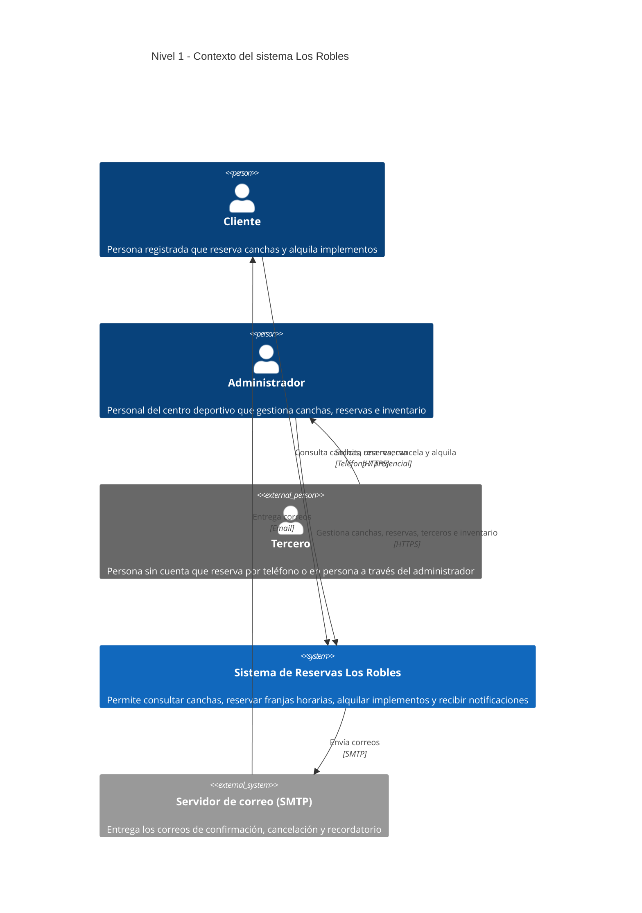
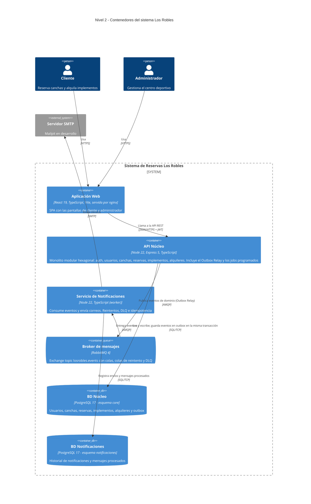
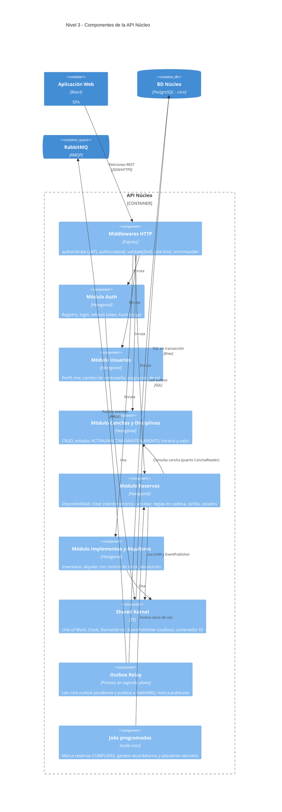
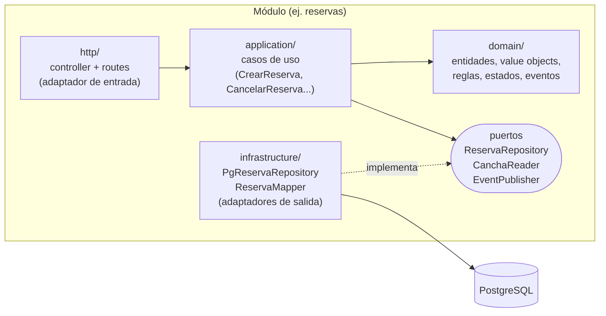
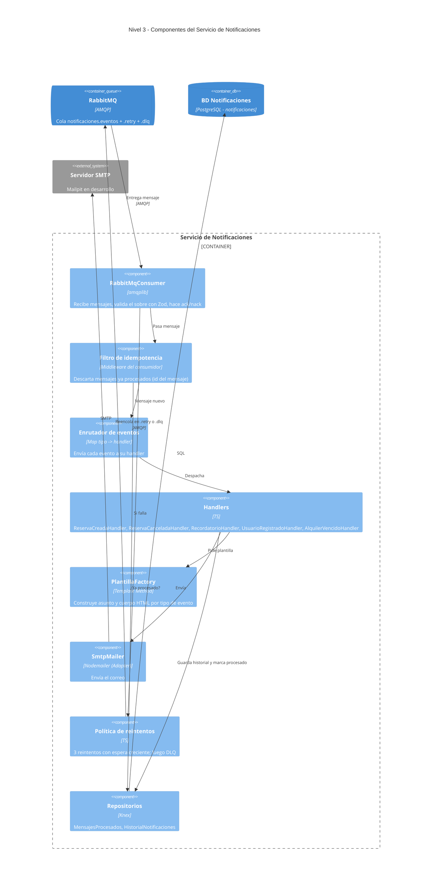
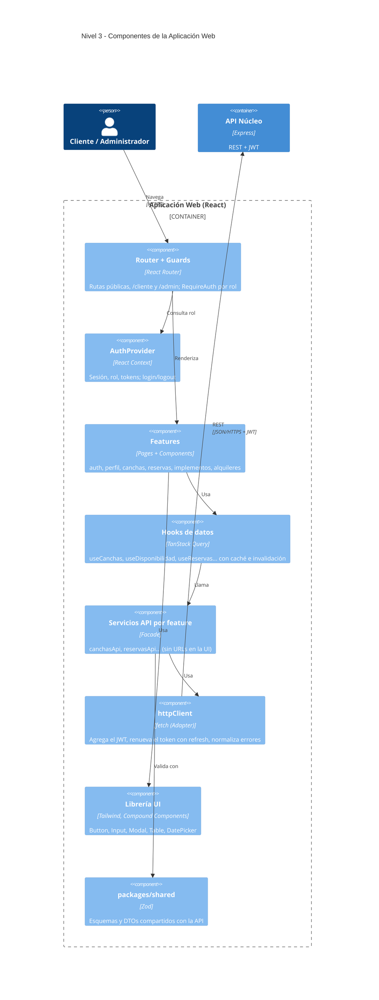
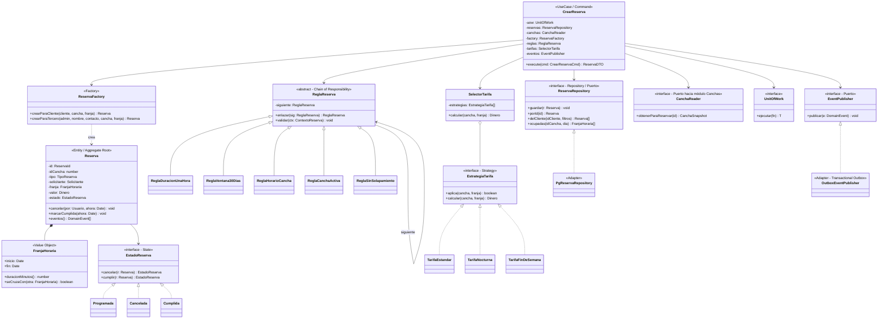
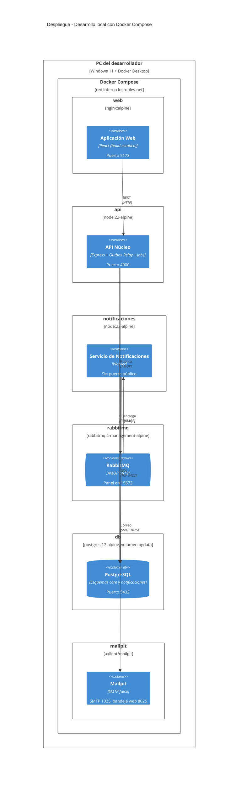
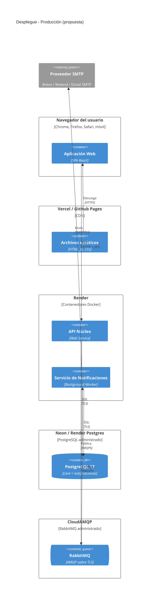
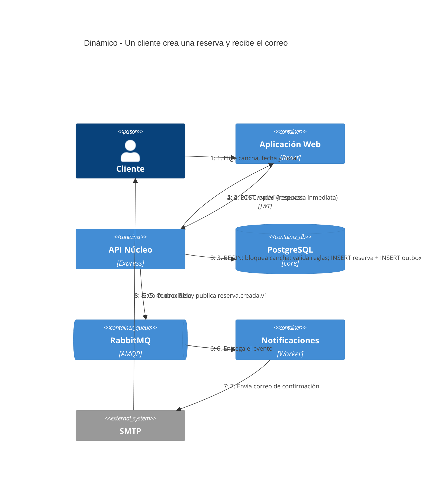

# Modelo C4 — Centro Deportivo Los Robles (v2)

> Diagramas del sistema según el modelo C4 (Simon Brown): **Contexto → Contenedores → Componentes → Código**, más el diagrama de **Despliegue**.
> Escritos en Mermaid: GitHub los muestra directamente. Arquitectura de referencia: [ARQUITECTURA.md](./ARQUITECTURA.md).

---

## Nivel 1 — Diagrama de Contexto

¿Quién usa el sistema y con qué sistemas externos habla?

| Elemento | Descripción |
|---|---|
| **Cliente** | Se registra, reserva canchas (1 h, hasta 30 días), cancela con 2 h de anticipación, alquila implementos |
| **Administrador** | CRUD de canchas, disciplinas e implementos; ve y cancela cualquier reserva; reserva a nombre de terceros |
| **Tercero** | No usa el sistema directamente; queda registrado con nombre y contacto en la reserva |
| **Servidor SMTP** | Externo. En desarrollo se reemplaza por **Mailpit** |

---

## Nivel 2 — Diagrama de Contenedores

¿De qué piezas desplegables se compone el sistema y cómo se comunican?

| Contenedor | Tecnología | Responsabilidad | Se comunica con |
|---|---|---|---|
| **Aplicación Web** | React 19 + Vite + Tailwind + TanStack Query, nginx | Interfaz de cliente y admin; guarda el JWT y lo renueva | API (REST) |
| **API Núcleo** | Express 5 + TS + Knex | Reglas de negocio y transacciones; publica eventos vía outbox | PostgreSQL `core`, RabbitMQ |
| **Servicio de Notificaciones** | Node + TS + amqplib + Nodemailer | Traduce eventos en correos; no expone HTTP público | RabbitMQ, PostgreSQL `notificaciones`, SMTP |
| **RabbitMQ** | RabbitMQ 4 | Desacopla núcleo y notificaciones; garantiza entrega *at-least-once* | API, Notificaciones |
| **PostgreSQL** | PostgreSQL 17 (un servidor, dos esquemas con usuarios distintos) | Persistencia de cada servicio por separado | API (`core`), Notificaciones (`notificaciones`) |

---

## Nivel 3 — Componentes de la API Núcleo

Reglas de dependencia entre módulos:
- Un módulo **no lee tablas de otro**. Reservas pregunta por una cancha a través del puerto `CanchaReader`, que implementa el módulo Canchas.
- Todo módulo escribe a la BD **solo** a través de su repositorio y del Unit of Work del Shared Kernel.
- Los eventos salen **solo** por el `EventPublisher`, que escribe en `core.outbox` dentro de la transacción en curso.

### Estructura interna de cada módulo (hexagonal)

---

## Nivel 3 — Componentes del Servicio de Notificaciones

---

## Nivel 3 — Componentes de la Aplicación Web

---

## Nivel 4 — Código: módulo Reservas

Muestra cómo se aplican los patrones de diseño en el módulo más crítico.

---

## Diagrama de Despliegue — Desarrollo local (Docker Compose)

## Diagrama de Despliegue — Producción (propuesta, planes gratuitos)

---

## Diagrama dinámico — Crear una reserva (de punta a punta)

