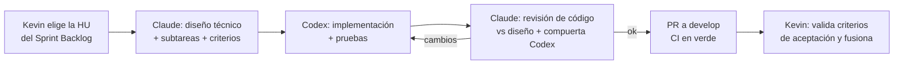

# SCRUM — Centro Deportivo Los Robles (v2)

> Marco de trabajo del proyecto. Arquitectura de referencia: [ARQUITECTURA.md](./ARQUITECTURA.md).
> Definido el 2026-11-20.

---

## 1. Equipo y roles

El proyecto lo desarrolla **una sola persona apoyada por IA**. Scrum se adapta así:

| Rol Scrum | Quién | Responsabilidades |
|---|---|---|
| **Product Owner** | Kevin | Dueño del Product Backlog: prioriza, escribe/aprueba criterios de aceptación y acepta o rechaza historias en la Review |
| **Scrum Master** | Kevin | Cuida que se cumplan las ceremonias, la DoD y el límite de trabajo en curso; registra impedimentos |
| **Developers** | Kevin + **Claude** (arquitecto / tech lead) + **Codex** (implementador) | Claude diseña cada historia (módulos, interfaces, criterios técnicos), Codex escribe el código, Claude lo revisa contra el diseño, Kevin integra y aprueba |

### Flujo de trabajo de cada historia

---

## 2. Cadencia y ceremonias

**Sprint de 2 semanas.** Sin fecha límite fija: el alcance se planea con la **velocidad real** medida sprint a sprint.

| Ceremonia | Cuándo | Duración | Cómo se hace (equipo de 1 + IA) | Artefacto que deja |
|---|---|---|---|---|
| **Sprint Planning** | Día 1 del sprint | ≤ 1 h | Kevin define el objetivo del sprint y elige historias según la velocidad; Claude las descompone en subtareas técnicas | Iteración en GitHub Projects con historias + objetivo escrito |
| **Daily** | Cada día de trabajo | 5 min | Comentario corto en el issue en curso: *hice / haré / bloqueos* | Historial en los issues |
| **Refinamiento** | Mitad del sprint | 30 min | Kevin + Claude revisan las próximas historias: criterios, estimación y DoR | Historias en estado **Ready** |
| **Sprint Review** | Último día | 30 min | Demo de lo terminado corriendo en Docker (`docker compose up`); Kevin como PO acepta o rechaza cada HU | `docs/sprints/sprint-N.md` (demo + aceptadas/rechazadas) |
| **Retrospectiva** | Después de la Review | 20 min | Formato *Mantener / Mejorar / Probar* | `docs/retros/sprint-N.md` con 1–2 acciones concretas |

---

## 3. Artefactos

| Artefacto | Dónde vive | Compromiso |
|---|---|---|
| **Product Backlog** | GitHub Projects → vista *Backlog* | **Product Goal:** "Que cualquier cliente reserve una cancha de Los Robles en menos de 1 minuto, sin dobles reservas y con confirmación por correo" (el pago en línea está fuera del alcance actual, ADR-006) |
| **Sprint Backlog** | GitHub Projects → vista *Sprint actual* (campo Iteración) | **Sprint Goal** escrito en la descripción de la iteración |
| **Incremento** | Rama `develop` desplegable con Docker | **Definition of Done** (sección 5) |

### Configuración de GitHub Projects
- **Campos:** `Status` (Backlog · Ready · In progress · In review · Done), `Iteración` (2 semanas), `Puntos` (número), `Épico` (selección), `Prioridad` (Must · Should · Could).
- **Vistas:** *Backlog* (tabla por prioridad), *Sprint actual* (tablero kanban), *Roadmap* (por iteración), *Burndown* (gráfico de puntos).
- **Etiquetas:** `epic:E0`…`epic:E7`, `tipo:historia`, `tipo:bug`, `tipo:chore`, `tipo:spike`, `servicio:api`, `servicio:web`, `servicio:notificaciones`, `servicio:infra`.
- **Plantilla de issue** `.github/ISSUE_TEMPLATE/historia.yml`: *Como … quiero … para …*, criterios de aceptación (Dado / Cuando / Entonces), notas técnicas, puntos.
- **Límite WIP:** máximo **2** historias en *In progress* a la vez.

---

## 4. Definition of Ready (DoR)
Una historia puede entrar al sprint si:
- [ ] Está escrita como *Como … quiero … para …*.
- [ ] Tiene criterios de aceptación verificables (Dado / Cuando / Entonces).
- [ ] Está estimada en puntos y es ≤ 8 (si es mayor, se divide).
- [ ] No depende de una historia que no esté terminada.
- [ ] Si toca UI, tiene boceto o referencia de pantalla.

## 5. Definition of Done (DoD)
- [ ] Código en rama `feature/HU-XX-descripcion` con PR hacia `develop`.
- [ ] Revisión técnica de Claude contra el diseño + compuerta de revisión de Codex aprobada.
- [ ] CI en verde: lint, typecheck, pruebas y build de los servicios afectados.
- [ ] Pruebas unitarias del dominio nuevo y prueba de integración de cada endpoint/consumidor nuevo.
- [ ] Endpoint documentado en OpenAPI / evento documentado en `packages/shared/events`.
- [ ] Funciona con `docker compose up` desde cero (migraciones incluidas).
- [ ] Kevin (PO) verificó todos los criterios de aceptación.
- [ ] Fusionado en `develop`; issue en **Done**.

## 6. Flujo Git
- `main` = versión estable (se libera al final de cada sprint) · `develop` = integración · `feature/HU-XX-*`, `fix/*`, `chore/*`.
- **Conventional Commits**: `feat(reservas): …`, `fix(auth): …`, `chore(infra): …`.
- `main` y `develop` protegidas: solo por PR con CI en verde.
- Al cerrar cada sprint: PR `develop → main` + tag `v0.N.0`.

---

## 7. Estimación y velocidad
- Puntos de historia en Fibonacci (1, 2, 3, 5, 8). Referencia: **3 pts** = un CRUD sencillo de un recurso con su pantalla y pruebas.
- **Velocidad inicial supuesta: ~20 pts/sprint.** Se recalcula al terminar el Sprint 1 con el promedio de lo realmente terminado y se replanifica el resto.
- Lo que no cumple la DoD al final del sprint **no cuenta** y vuelve al backlog.

---

## 8. Product Backlog

Prioridad: **M**ust · **S**hould · **C**ould. Servicio: `api` · `web` · `notif` · `infra`.

### E0 — Fundaciones técnicas (22 pts)
| ID | Historia | Servicio | Pts | Prio |
|---|---|---|---|---|
| HU-00 | Como equipo quiero el monorepo (api, web, notificaciones, shared) con ESLint, Prettier, Husky y CI en GitHub Actions para trabajar con calidad desde el día 1 | infra | 5 | M |
| HU-01 | Como equipo quiero `docker-compose.yml` con PostgreSQL, RabbitMQ, Mailpit y pgAdmin con healthchecks para levantar el entorno con un comando | infra | 3 | M |
| HU-02 | Como equipo quiero esquemas `core` y `notificaciones`, migraciones con Knex y seeds con contraseñas hasheadas para tener la BD reproducible | api | 5 | M |
| HU-03 | Como equipo quiero la base de la API (contenedor DI, manejo de errores, validación Zod, logger, `/health`, Swagger) | api | 3 | M |
| HU-04 | Como equipo quiero la base del front (router, layout, cliente HTTP, componentes UI básicos, Dockerfile con nginx) | web | 3 | M |
| HU-05 | Como equipo quiero la base del worker de notificaciones (conexión a RabbitMQ, exchange/colas desde `definitions.json`, Dockerfile) | notif | 3 | M |

### E1 — Autenticación y perfil (17 pts)
| ID | Historia | Servicio | Pts | Prio |
|---|---|---|---|---|
| HU-10 | Como visitante quiero **registrarme** con nombres, apellidos, correo, celular y contraseña | api, web | 3 | M |
| HU-11 | Como usuario quiero **iniciar sesión** y llegar a mi panel según mi rol | api, web | 5 | M |
| HU-12 | Como usuario quiero **cerrar sesión** | web | 1 | M |
| HU-13 | Como usuario quiero **ver mi perfil** | api, web | 2 | M |
| HU-14 | Como usuario quiero **editar mi perfil** y cambiar mi contraseña (pidiendo la actual) | api, web | 3 | M |
| HU-15 | Como admin quiero **dar o quitar el rol de administrador** a un usuario | api, web | 3 | S |

**HU-10 — criterios de aceptación**
- Dado un correo ya registrado (sin importar mayúsculas), cuando me registro, entonces veo "El correo ya está registrado" (409).
- La contraseña tiene mínimo 8 caracteres, una mayúscula y un número.
- El celular tiene 10 dígitos y empieza por 3.
- Al registrarme quedo con rol CLIENTE, con sesión iniciada, y se publica `usuario.registrado.v1`.

**HU-11 — criterios de aceptación**
- Con credenciales válidas recibo access token (15 min) y refresh token (7 días).
- Un CLIENTE entra a `/cliente`, un ADMIN a `/admin`; un CLIENTE que intente abrir `/admin` es redirigido.
- Con credenciales inválidas veo "Correo o contraseña incorrectos" sin revelar cuál falló.
- Tras 5 intentos fallidos en 15 min desde la misma IP, recibo 429.

### E2 — Disciplinas y canchas (15 pts)
| ID | Historia | Servicio | Pts | Prio |
|---|---|---|---|---|
| HU-20 | Como admin quiero gestionar **disciplinas** (CRUD) | api, web | 3 | S |
| HU-21 | Como admin quiero **crear una cancha** con disciplina, valor por hora y horario | api, web | 3 | M |
| HU-22 | Como admin quiero **editar una cancha** | api, web | 2 | M |
| HU-23 | Como admin quiero **cambiar el estado** de una cancha (ACTIVA / INACTIVA / MANTENIMIENTO) | api, web | 2 | M |
| HU-24 | Como usuario quiero **ver el listado de canchas** filtrando por disciplina | api, web | 3 | M |
| HU-25 | Como usuario quiero **ver el detalle** de una cancha | api, web | 2 | M |

### E3 — Reservas de clientes (24 pts)
| ID | Historia | Servicio | Pts | Prio |
|---|---|---|---|---|
| HU-30 | Como cliente quiero **ver la disponibilidad** de una cancha en una fecha | api, web | 5 | M |
| HU-31 | Como cliente quiero **reservar** una cancha en una franja libre | api, web | 8 | M |
| HU-32 | Como cliente quiero **ver mis reservas** (próximas e historial) | api, web | 3 | M |
| HU-33 | Como cliente quiero **ver el detalle** de una reserva | api, web | 2 | M |
| HU-34 | Como cliente quiero **cancelar** una reserva con al menos 2 h de anticipación | api, web | 3 | M |
| HU-35 | Como cliente quiero ver el **valor** de la reserva según la tarifa aplicable | api, web | 3 | S |

**HU-31 — criterios de aceptación**
- No puedo reservar en fecha pasada, ni a más de 30 días, ni en horas que ya pasaron hoy.
- Solo se ofrecen franjas de 1 h en hora entera dentro del horario de la cancha.
- Si la cancha no está ACTIVA, recibo 422 "La cancha no está disponible".
- Si dos clientes piden la misma franja al mismo tiempo, solo uno lo logra; el otro recibe 409 "El horario ya fue reservado" (probado con peticiones concurrentes).
- La reserva y su evento `reserva.creada.v1` se guardan en la misma transacción (outbox).

### E4 — Administración de reservas (15 pts)
| ID | Historia | Servicio | Pts | Prio |
|---|---|---|---|---|
| HU-40 | Como admin quiero **ver todas las reservas** filtrando por fecha, cancha y estado | api, web | 5 | M |
| HU-41 | Como admin quiero **reservar a nombre de un tercero** (nombre + contacto) | api, web | 5 | M |
| HU-42 | Como admin quiero **cancelar cualquier reserva** indicando el motivo | api, web | 2 | M |
| HU-43 | Como sistema quiero marcar como **CUMPLIDAS** las reservas cuya hora ya pasó | api | 3 | S |

### E5 — Notificaciones asíncronas (20 pts)
| ID | Historia | Servicio | Pts | Prio |
|---|---|---|---|---|
| HU-50 | Como equipo quiero el **Transactional Outbox** y el relay que publica a RabbitMQ para que ningún evento se pierda | api | 5 | M |
| HU-51 | Como cliente quiero recibir un **correo de confirmación** al reservar | notif | 3 | M |
| HU-52 | Como cliente quiero recibir un **correo** cuando mi reserva se cancela | notif | 2 | M |
| HU-53 | Como cliente nuevo quiero recibir un **correo de bienvenida** | notif | 2 | C |
| HU-54 | Como cliente quiero un **recordatorio** 2 h antes de mi reserva | api, notif | 3 | S |
| HU-55 | Como equipo queremos **reintentos, DLQ y consumidor idempotente** para que un fallo del correo no pierda ni duplique mensajes | notif | 5 | M |

**HU-51 — criterios de aceptación**
- Al crear una reserva, en ≤ 30 s llega a Mailpit un correo con cancha, fecha, hora y valor.
- Si el worker está apagado al crear la reserva, el correo llega cuando se enciende.
- Si el mismo evento se entrega dos veces, solo se envía un correo.

### E6 — Implementos y alquiler (15 pts)
| ID | Historia | Servicio | Pts | Prio |
|---|---|---|---|---|
| HU-60 | Como admin quiero gestionar el **inventario de implementos** | api, web | 3 | S |
| HU-61 | Como cliente quiero **ver los implementos disponibles** | api, web | 2 | S |
| HU-62 | Como cliente quiero **alquilar implementos** sin exceder el stock | api, web | 5 | S |
| HU-63 | Como admin quiero **registrar la devolución** de un alquiler | api, web | 3 | S |
| HU-64 | Como cliente quiero un **aviso** si no he devuelto un implemento a tiempo | api, notif | 2 | C |

### E7 — Despliegue y cierre (21 pts)
| ID | Historia | Servicio | Pts | Prio |
|---|---|---|---|---|
| HU-70 | Como equipo queremos **desplegar** web, api, notificaciones, PostgreSQL y RabbitMQ con CD desde `main` | infra | 8 | M |
| HU-71 | Como equipo queremos **pruebas E2E** (registro → reservar → correo → cancelar) | web | 5 | S |
| HU-72 | Como admin quiero un **dashboard** de ocupación por cancha | api, web | 5 | C |
| HU-73 | Como equipo queremos **observabilidad básica**: logs estructurados con `correlationId` entre api y notificaciones | infra | 3 | S |

**Total del backlog: 149 puntos.**

---

## 9. Plan de releases (con velocidad supuesta de ~20 pts)

| Sprint | Semanas | Sprint Goal | Historias | Pts | Release |
|---|---|---|---|---|---|
| **0** | 1–2 | "El entorno completo se levanta con `docker compose up` y el CI está en verde" | HU-00…05 | 22 | `v0.1.0` |
| **1** | 3–4 | "Un usuario puede registrarse, entrar según su rol y gestionar su perfil" | HU-10…15 | 17 | `v0.2.0` |
| **2** | 5–6 | "El admin gestiona canchas, todos las consultan y los eventos ya viajan por el outbox" | HU-20…25, HU-50 | 20 | `v0.3.0` |
| **3** | 7–8 | "Un cliente puede reservar sin dobles reservas y cancelar" | HU-30…34 | 21 | `v0.4.0` — **MVP** |
| **4** | 9–10 | "El admin controla todas las reservas y el cliente ve el valor" | HU-35, HU-40…43 | 18 | `v0.5.0` |
| **5** | 11–12 | "Cada reserva y cancelación genera su correo, sin perder ni duplicar mensajes" | HU-51…55 | 15 | `v0.6.0` |
| **6** | 13–14 | "Los clientes pueden alquilar implementos" | HU-60…64 | 15 | `v0.7.0` |
| **7** | 15–16 | "Los Robles en producción, probado de punta a punta" | HU-70…73 | 21 | `v1.0.0` |

> El plan es una proyección, no un compromiso: después del Sprint 1 se recalcula con la velocidad real y se reordena el backlog si el PO cambia prioridades.

---

## 10. Riesgos e impedimentos conocidos

| Riesgo | Impacto | Mitigación |
|---|---|---|
| Equipo de una sola persona (sin redundancia) | Alto | La IA cubre diseño, código y revisión; la DoD exige documentación para que cualquiera pueda continuar |
| Curva de aprendizaje de RabbitMQ y del outbox | Medio | Spike de 1 día dentro de HU-05; las notificaciones van después del MVP (Sprint 5) |
| Planes gratuitos de despliegue (contenedores que se duermen) | Medio | Probar el despliegue temprano con un *walking skeleton* al final del Sprint 0 |
| Cambios de alcance sin fecha límite | Medio | El Product Goal y la prioridad MoSCoW filtran lo que entra |
